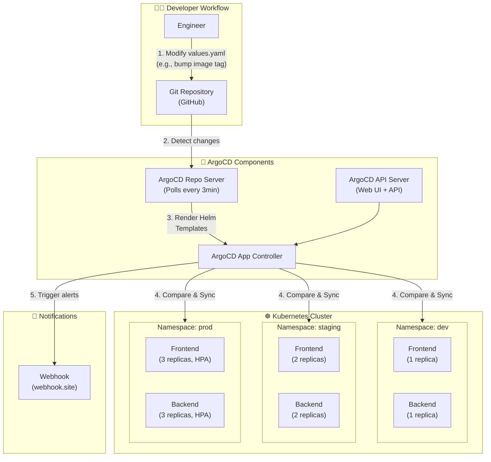
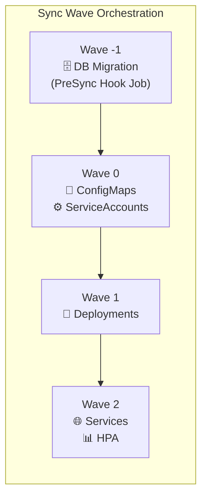
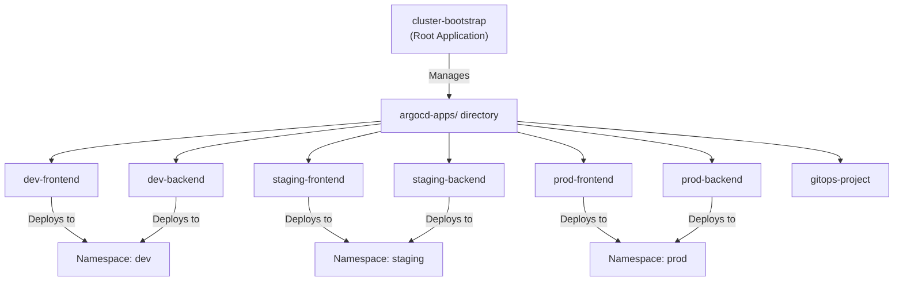
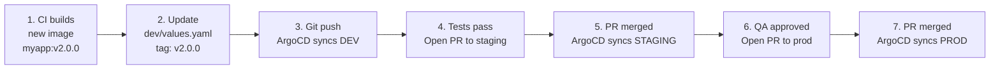

# 🚀 Kubernetes GitOps Deployment Pipeline with ArgoCD

[](https://argo-cd.readthedocs.io/)
[](https://kubernetes.io/)
[](https://helm.sh/)
[](https://opengitops.dev/)

> A production-grade GitOps continuous delivery pipeline using ArgoCD to manage multi-environment Kubernetes deployments with automated synchronization, self-healing, and declarative configuration.

---

## 📋 Table of Contents

- [Architecture Overview](#architecture-overview)
- [System Architecture Diagram](#system-architecture-diagram)
- [Repository Structure](#repository-structure)
- [Prerequisites](#prerequisites)
- [Quick Start](#quick-start)
- [Detailed Setup Guide](#detailed-setup-guide)
- [The App of Apps Pattern](#the-app-of-apps-pattern)
- [Environment Promotion Strategy](#environment-promotion-strategy)
- [Sync Waves & Hooks](#sync-waves--hooks)
- [Custom Health Checks](#custom-health-checks)
- [Notifications Configuration](#notifications-configuration)
- [Rollback Procedure](#rollback-procedure)
- [Testing & Validation](#testing--validation)
- [Secret Management](#secret-management)
- [Troubleshooting](#troubleshooting)
- [Demo Video](#demo-video)

---

## Architecture Overview

This project implements a complete GitOps workflow using ArgoCD as the continuous delivery engine for Kubernetes. The pipeline follows the **pull-based deployment model** where ArgoCD (running inside the cluster) continuously monitors a Git repository and automatically reconciles the cluster state to match the desired state defined in Git.

### Key Design Decisions

| Decision | Choice | Rationale |
|----------|--------|-----------|
| Environment Strategy | Directory-per-environment | Single branch, transparent, auditable, no merge conflicts |
| Templating Engine | Helm | Native value overrides, conditional logic, reusable templates |
| Deployment Pattern | App of Apps | Scalable bootstrap, single entry point for entire cluster |
| Sync Policy | Automated + Self-Heal + Prune | Zero-touch deployments, automatic drift correction |
| Secret Management | Kubernetes Secrets + .env.example | No plaintext secrets in Git |

### Core Components

- **ArgoCD Application Controller** — Continuously compares live state vs. desired state
- **ArgoCD Repo Server** — Clones and caches Git repository, renders Helm templates
- **ArgoCD API Server** — Exposes gRPC/REST API and Web UI
- **Root Application (cluster-bootstrap)** — Bootstraps all child apps via App of Apps pattern
- **Helm Charts** — Parameterized application definitions (frontend + backend)
- **Environment Overrides** — Per-environment values files (dev/staging/prod)

---

## System Architecture Diagram



### Sync Wave Orchestration



---

## Repository Structure

```
gitops-manifest-repo/
├── apps/                              # Base Helm charts
│   ├── frontend/                      # Frontend (nginx) Helm chart
│   │   ├── Chart.yaml
│   │   ├── values.yaml                # Default values
│   │   └── templates/
│   │       ├── _helpers.tpl
│   │       ├── deployment.yaml        # Sync Wave: 1
│   │       ├── service.yaml           # Sync Wave: 2
│   │       ├── configmap.yaml         # Sync Wave: 0
│   │       ├── hpa.yaml               # Conditional HPA
│   │       └── serviceaccount.yaml
│   └── backend/                       # Backend (http-echo) Helm chart
│       ├── Chart.yaml
│       ├── values.yaml                # Default values
│       └── templates/
│           ├── _helpers.tpl
│           ├── deployment.yaml        # Sync Wave: 1
│           ├── service.yaml           # Sync Wave: 2
│           ├── migration-job.yaml     # PreSync Hook (Wave: -1)
│           ├── hpa.yaml               # Conditional HPA
│           └── serviceaccount.yaml
├── environments/                      # Environment-specific overrides
│   ├── dev/
│   │   ├── frontend-values.yaml       # 1 replica, minimal resources
│   │   └── backend-values.yaml
│   ├── staging/
│   │   ├── frontend-values.yaml       # 2 replicas, moderate resources
│   │   └── backend-values.yaml
│   └── prod/
│       ├── frontend-values.yaml       # 3 replicas, HPA enabled, max resources
│       └── backend-values.yaml
├── argocd-apps/                       # ArgoCD Application CRDs (App of Apps)
│   ├── dev-frontend.yaml
│   ├── dev-backend.yaml
│   ├── staging-frontend.yaml
│   ├── staging-backend.yaml
│   ├── prod-frontend.yaml
│   ├── prod-backend.yaml
│   └── gitops-project.yaml           # ArgoCD AppProject
├── argocd-config/                     # ArgoCD configuration
│   ├── argocd-cm.yaml                 # Custom health checks (Lua scripts)
│   ├── argocd-notifications-cm.yaml   # Notification triggers & templates
│   └── argocd-notifications-secret.yaml
├── root-app.yaml                      # Root Application (cluster bootstrap)
├── kind-config.yaml                   # Kind cluster configuration
├── setup-cluster.sh                   # Automated setup script
├── teardown-cluster.sh                # Cluster teardown script
├── .env.example                       # Environment variables template
├── .gitignore
└── README.md                          # This file
```

---

## Prerequisites

| Tool | Version | Purpose |
|------|---------|---------|
| Docker | 20.10+ | Container runtime for Kind |
| Kind | 0.20+ | Local Kubernetes cluster |
| kubectl | 1.28+ | Kubernetes CLI |
| Helm | 3.12+ | Chart templating |
| Git | 2.40+ | Version control |
| ArgoCD CLI | 2.9+ | (Optional) CLI interaction |

---

## Quick Start

```bash
# 1. Clone the repository
git clone https://github.com/raghavendra2006/Implement-a-Kubernetes-GitOps-Deployment-Pipeline-with-ArgoCD.git
cd Implement-a-Kubernetes-GitOps-Deployment-Pipeline-with-ArgoCD

# 2. Run the setup script
chmod +x setup-cluster.sh
./setup-cluster.sh

# 3. Access ArgoCD UI
# URL: https://localhost:30080
# Username: admin
# Password: (printed by setup script)
```

---

## Detailed Setup Guide

### Step 1: Provision the Kubernetes Cluster

```bash
kind create cluster --name gitops-cluster --config kind-config.yaml
```

This creates a cluster with 1 control-plane and 2 worker nodes with port mappings for NodePort access.

### Step 2: Install ArgoCD

```bash
kubectl create namespace argocd
kubectl apply -n argocd -f https://raw.githubusercontent.com/argoproj/argo-cd/stable/manifests/install.yaml
kubectl wait --for=condition=available --timeout=300s deployment/argocd-server -n argocd
```

### Step 3: Expose ArgoCD UI

```bash
kubectl patch svc argocd-server -n argocd -p '{"spec": {"type": "NodePort", "ports": [{"port": 443, "targetPort": 8080, "nodePort": 30080}]}}'
```

### Step 4: Retrieve Admin Password

```bash
kubectl -n argocd get secret argocd-initial-admin-secret -o jsonpath="{.data.password}" | base64 -d
```

### Step 5: Create Environment Namespaces

```bash
kubectl create namespace dev
kubectl create namespace staging
kubectl create namespace prod
```

### Step 6: Apply ArgoCD Configuration

```bash
kubectl apply -f argocd-config/argocd-cm.yaml
kubectl apply -f argocd-config/argocd-notifications-cm.yaml
kubectl apply -f argocd-config/argocd-notifications-secret.yaml
```

### Step 7: Bootstrap the Cluster

```bash
kubectl apply -f root-app.yaml
```

This single command bootstraps the entire cluster via the App of Apps pattern.

---

## The App of Apps Pattern

The **App of Apps** pattern is a scalable approach to bootstrapping an entire Kubernetes cluster through a single ArgoCD Application. The `root-app.yaml` defines a "parent" Application that points to the `argocd-apps/` directory. ArgoCD reads all YAML files in that directory and creates child Applications, each targeting a specific environment namespace.

This pattern provides several advantages:

- **Single entry point**: One `kubectl apply` bootstraps the entire cluster
- **Declarative management**: Adding a new application is as simple as adding a YAML file to `argocd-apps/`
- **Consistent configuration**: All applications inherit project-level policies from `gitops-project.yaml`
- **Atomic operations**: The root app tracks the health of all child applications



---

## Environment Promotion Strategy

The promotion strategy follows a **Git-driven, zero-touch workflow**:

### Promotion Flow: Dev → Staging → Production



#### Step-by-Step Process:

1. **Build**: CI system builds a new Docker image (e.g., `myapp:v2.0.0`)
2. **Update Dev**: Edit `environments/dev/backend-values.yaml`, change `image.tag` to `v2.0.0`
3. **Commit & Push**: `git commit -am "chore(dev): bump backend to v2.0.0" && git push`
4. **Auto-Sync Dev**: ArgoCD detects the change and syncs the dev namespace
5. **Promote to Staging**: Copy the image tag change to `environments/staging/backend-values.yaml`
6. **Auto-Sync Staging**: ArgoCD syncs the staging namespace
7. **Promote to Production**: Copy the image tag change to `environments/prod/backend-values.yaml`
8. **Auto-Sync Production**: ArgoCD syncs the production namespace

> **Key Principle**: No `kubectl apply` commands are ever run. All changes flow through Git.

---

## Sync Waves & Hooks

### Wave Ordering

| Wave | Resources | Purpose |
|------|-----------|---------|
| -1 | DB Migration Job (PreSync) | Schema migrations before app update |
| 0 | ConfigMaps, ServiceAccounts | Configuration and identity |
| 1 | Deployments | Application pods |
| 2 | Services, HPA | Networking and autoscaling |

### PreSync Hook: Database Migration

The backend chart includes a `migration-job.yaml` that runs as a **PreSync** hook:

```yaml
annotations:
  argocd.argoproj.io/hook: PreSync
  argocd.argoproj.io/hook-delete-policy: HookSucceeded
  argocd.argoproj.io/sync-wave: "-1"
```

This ensures database schema is updated **before** any new application pods are deployed.

---

## Custom Health Checks

Custom Lua scripts are defined in `argocd-config/argocd-cm.yaml` to extend ArgoCD's health assessment:

### cert-manager Certificate Health Check

```lua
hs = {}
if obj.status ~= nil then
  if obj.status.conditions ~= nil then
    for i, condition in ipairs(obj.status.conditions) do
      if condition.type == "Ready" and condition.status == "True" then
        hs.status = "Healthy"
        hs.message = condition.message
        return hs
      end
    end
  end
end
hs.status = "Progressing"
hs.message = "Waiting for certificate"
return hs
```

### Batch Job Health Check

```lua
hs = {}
if obj.status ~= nil then
  if obj.status.succeeded ~= nil and obj.status.succeeded > 0 then
    hs.status = "Healthy"
    hs.message = "Job completed successfully"
    return hs
  end
  if obj.status.failed ~= nil and obj.status.failed > 0 then
    hs.status = "Degraded"
    hs.message = "Job failed"
    return hs
  end
end
hs.status = "Progressing"
hs.message = "Job is running"
return hs
```

---

## Notifications Configuration

Notifications are configured via `argocd-config/argocd-notifications-cm.yaml`:

### Configured Triggers

| Trigger | Condition | Action |
|---------|-----------|--------|
| on-sync-succeeded | Sync phase = Succeeded | Send webhook |
| on-sync-failed | Sync phase = Error/Failed | Send webhook |
| on-health-degraded | Health status = Degraded | Send webhook |

### Setup

1. Go to [webhook.site](https://webhook.site) and get your unique URL
2. Update `argocd-config/argocd-notifications-secret.yaml` with your URL
3. Apply: `kubectl apply -f argocd-config/argocd-notifications-secret.yaml`

---

## Rollback Procedure

### Git-Driven Rollback (Recommended)

```bash
# 1. Identify the problematic commit
git log --oneline

# 2. Revert the commit
git revert <commit-hash>

# 3. Push the revert
git push origin main

# 4. ArgoCD automatically syncs to the reverted state
# Monitor in ArgoCD UI or:
kubectl get applications -n argocd
```

### ArgoCD UI Rollback (Alternative)

1. Navigate to the application in ArgoCD UI
2. Click **History and Rollback**
3. Select the previous healthy revision
4. Click **Rollback**

> **Important**: In a true GitOps workflow, always prefer the Git revert method as it maintains Git as the single source of truth.

---

## Testing & Validation

### Test 1: Configuration Drift (Self-Healing)

```bash
# Manually delete a service
kubectl delete svc staging-frontend -n staging

# Within seconds, ArgoCD detects the drift and recreates the service
kubectl get svc -n staging -w
```

### Test 2: Failed Sync (Notifications)

```bash
# Intentionally introduce a syntax error
# Edit environments/dev/frontend-values.yaml with invalid YAML
# Push the change
# ArgoCD will mark the app as "Sync Failed"
# Check webhook.site for the notification
```

### Test 3: Dependency Ordering (PreSync Hook)

```bash
# Trigger a backend sync and observe:
# 1. Migration Job starts first (PreSync, Wave -1)
# 2. After Job succeeds, Deployment rolls out (Wave 1)
# 3. Finally, Service updates (Wave 2)
kubectl get pods -n dev -w
```

---

## Secret Management

This project follows the principle of **never committing plaintext secrets to Git**:

- **ArgoCD admin password**: Auto-generated by ArgoCD, stored as a Kubernetes Secret
- **Webhook URLs**: Stored in `argocd-notifications-secret.yaml` using Kubernetes Secret with `stringData`
- **`.env.example`**: Provided as a template showing required variables without real values
- **`.gitignore`**: Excludes `.env`, `*.key`, `*.pem`, and secret files

For production deployments, consider:
- [Bitnami Sealed Secrets](https://sealed-secrets.netlify.app/)
- [External Secrets Operator](https://external-secrets.io/)
- [Mozilla SOPS](https://github.com/getsops/sops)

---

## Troubleshooting

| Issue | Cause | Solution |
|-------|-------|----------|
| App stuck OutOfSync | Mutating admission webhooks | Add `ignoreDifferences` to Application CRD |
| PreSync hook fails | Job configuration error | Check pod logs: `kubectl logs job/<name> -n <ns>` |
| Self-heal not working | syncPolicy not set | Verify `automated.selfHeal: true` in Application |
| Notifications not firing | Incorrect secret | Verify webhook URL in argocd-notifications-secret |
| App shows Unknown health | Missing health check | Add custom Lua script to argocd-cm |

---

## Demo Video

> 📹 **Walkthrough & Demonstration:** A 5–10 minute narrated demonstration recording proving end-to-end functionality.

The demonstration covers:
1. ✅ Committing a change to the development environment
2. ✅ ArgoCD detecting the change and auto-syncing
3. ✅ Promoting changes from dev → staging via Git
4. ✅ Configuration drift test (self-healing)
5. ✅ Rollback via `git revert`
6. ✅ Webhook notifications on sync events

---

## Author

Built as part of the Cloud Computing & DevOps assessment for the Global Placement Program.
